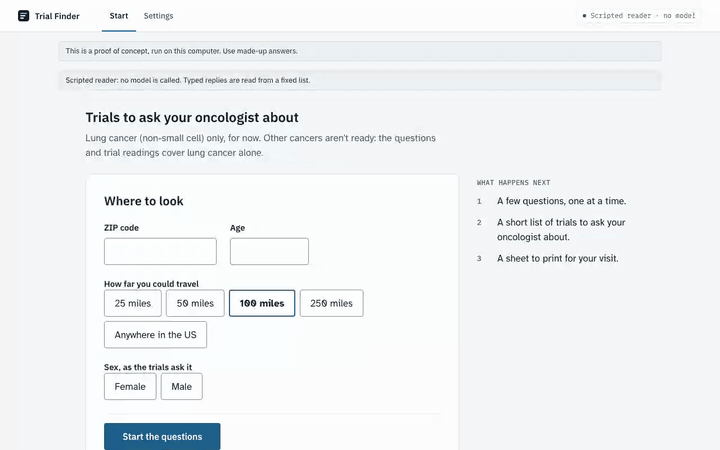
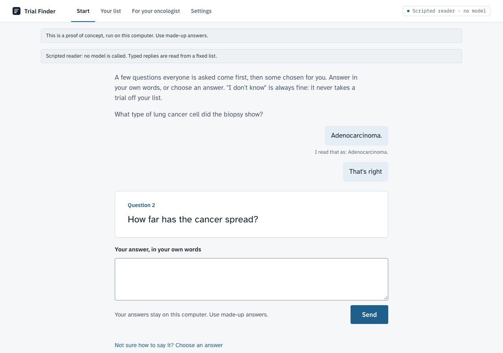
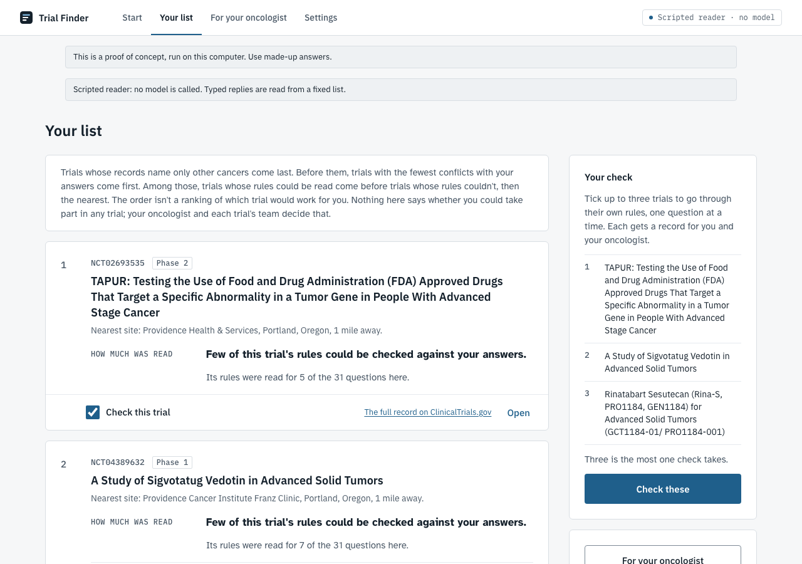
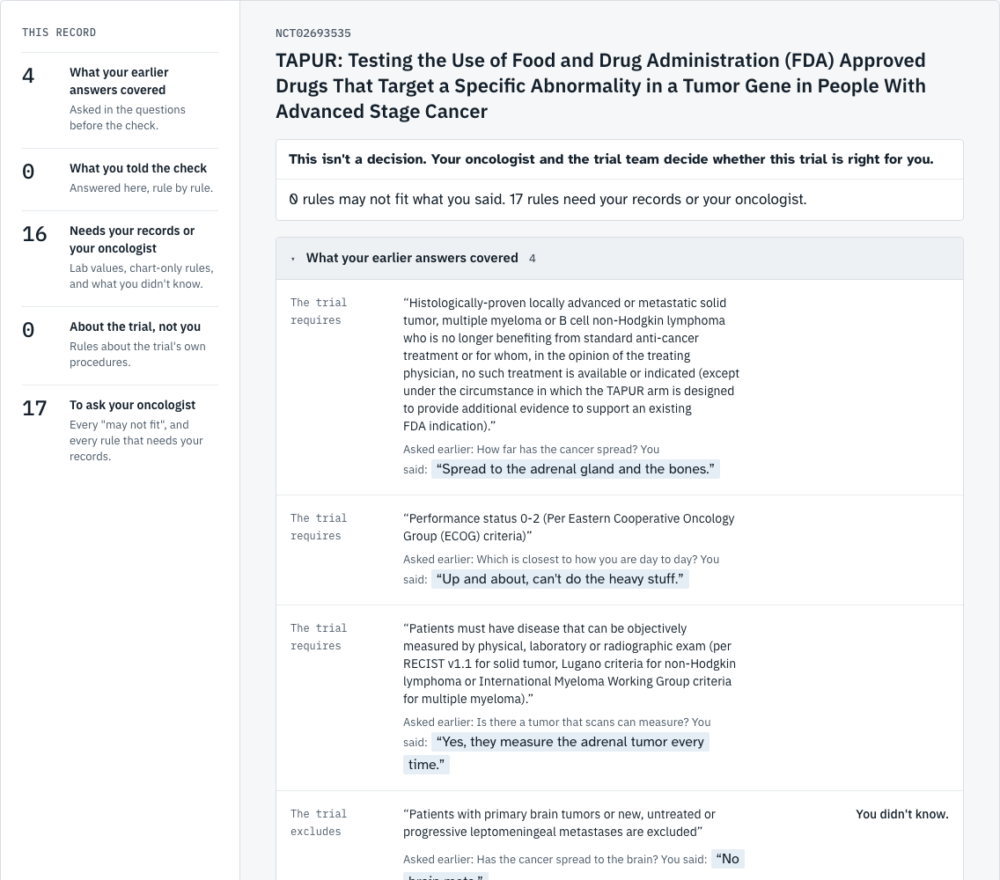
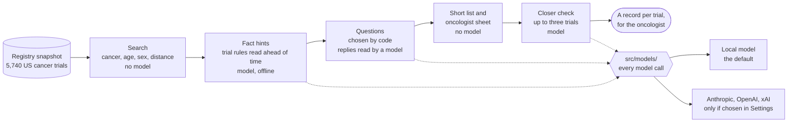

# Clinical Trial Finder

[](LICENSE) [](https://nodejs.org/)

**An AI assistant that helps a person with cancer find clinical trials worth asking their oncologist about.** It asks what they know about their cancer and their treatment so far, searches a saved copy of ClinicalTrials.gov, and gives back a short list. For each trial it says why the trial may fit, what's still unknown and what to ask. It never says a person is eligible. Their oncologist and the trial team decide that.

Every stage is measured. The eval harness, the made-up patients it runs and the results it committed are as much the product as the page.



*The page in its scripted mode, with made-up answers. Each typed reply gets the local model's recorded reading of it, and the check replays a recorded reading of the trial's rules. Most questions are sped up.*

## The problem

When standard treatment stops working, a trial may be the next option. ClinicalTrials.gov lists them all, but a search for one cancer type returns hundreds of studies, each with pages of eligibility rules written for doctors. Many of those rules turn on facts a patient may not know, such as which genetic changes their tumor has. The trials most worth finding, early-phase studies open to many cancers, often don't name the patient's cancer at all.

Most people never get as far as being ruled out. In a pooled analysis of 8,883 patients, 55.6% had no trial available where they were treated, and 8.1% enrolled ([research, §1](work/0000-product/research.md)). The largest barrier is that no one connects a trial to the person. Published matchers do well when they start from a full medical record. What hadn't been measured is how close a conversation gets when it starts from a person who knows only part of their own history. That's the question this project answers.

## What it does

1. **Asks.** A short conversation in plain language: the cancer, how far it has spread, the treatments so far and how each ended, how active the person is, and how far they can travel. "I don't know" is an expected answer.
2. **Searches** a saved copy of the registry for recruiting trials for that cancer near the person, including trials open to many cancer types.
3. **Asks what matters next.** Each further question is the one whose answer would change the list most. It stops when more questions wouldn't.
4. **Hands over** a short list, each trial with its reasons, its unknowns and its nearest site, and a sheet of questions to take to the oncologist.
5. **Checks a few closely.** The person picks up to three trials. For each, an agent goes through the trial's own rules, asks only what wasn't already answered, and writes a record of what fits, what may not and what to ask.

<p>
  
  
  
</p>

Made-up answers, from the page's scripted mode.

## What it never does

- **It never says a person is eligible, or should join.** The list, the sheet and every record say the oncologist and the trial team decide. A test scans every fixed sentence on the page for verdict words, and the browser test scans every screen.
- **Nothing a person doesn't know removes a trial, and nothing a model reads removes one either.** A model's reading of a trial's rules is a "may not fit" hint, shown in the trial's own words, and a reason to ask. On held-out trials, between a quarter and a third of the rules a model read would have wrongly ruled a person out ([facts.md](docs/facts.md)). That's why reading never removes a trial.
- **No real patient data.** Every patient is made up, in fixtures, tests, logs and results.
- **Runs on one computer.** Searches use the saved registry, with no network. The model runs locally by default. A hosted one (Anthropic, OpenAI or xAI) is used only when a person picks it in Settings with their own key.
- **Contacts no one.** No email, no messages, no calls to a trial site. The person takes the sheet to their oncologist.

## What was measured

Each number links to its committed result, run on made-up patients and the 2026-10 registry snapshot. The detail and the limits are in each part's doc.

| Measured | Result | What it doesn't show |
| --- | --- | --- |
| **How close a short conversation gets to a full record:** 17 held-out made-up patients who know only part of their record | The conversation keeps **85%** of the short list the full record gives. The 8 fixed questions alone keep 72%, and a person who knew everything, 91% ([result](evals/results/questions/06-8eea38fafad5.json), [questions.md](docs/questions.md)) | Agreement with a full-record run of the same finder, not with clinicians' judgment. The patients were written here. |
| **Search recall:** a held-out random sample of the snapshot, labelled for lung cancer | **76 of 82** relevant trials kept, 92.7% (95% interval 84.9–96.6%) ([result](evals/results/search/01-a3e87584fb11.json), [search.md](docs/search.md)) | Short of the 95% bar set before measuring, accepted as the finding. Labels written here. |
| **Trials for other cancers moved down** | Short-list places they held, on held-out: **35 of 162 down to 6** ([result](evals/results/questions/06-8eea38fafad5.json), [labels](evals/results/search/other/01-d16e940b9df3.json), [search.md](docs/search.md)) | 14 of 43 such trials are still unmarked. About 1 relevant trial in 200 is marked: moved down, not hidden. |
| **Reading a person's own words,** on a hosted model | Claude Haiku 4.5 read **527 of 527** held-out replies: 324 of 326 stated answers right, and none of 201 "don't know"s turned into an answer ([result](evals/results/questions/reads/heldout-claude-haiku-4-5-8cb01749-schema.json), [questions.md](docs/questions.md#on-a-hosted-model)) | The replies were written to be clear. Two plain "No"s were read as "Yes". |
| **The closer check,** on 50 held-out patient–trial pairs | **27%** of questions saved by not asking again. Caught **5 of 16** trials that clearly don't fit, and said "may not fit" wrongly on **27 of 34** others ([result](evals/results/check/01-1db863f7b74c.json), [check.md](docs/check.md)) | The false-alarm rate is high, and still open after two slices on it. The record is written as questions for that reason. |
| **Outside judgments,** search only | NIST's TREC assessors: **1,290 of 1,669** relevant trials kept, 77.3%. NIH-TrialBench: **26 of 29** target trials kept ([TREC](evals/results/benchmark/search/trec/01-80fcdb226e48.json), [NIH-TrialBench](evals/results/benchmark/search/trialbench/01-4399149b1b7a.json), [benchmark.md](docs/benchmark.md)) | Other cancers, not lung. TREC judged trials for the patients' other conditions too, which a cancer search drops by design. |

The local model is Qwen3.6-35B-A3B (MLX, 8-bit), at temperature 0 and seed 20260921. Claude Haiku 4.5 ran at temperature 0, with no seed, since the API has none. Each result file records its own model, quantization, temperature and seed.

## How it works



- **Search** ([search.md](docs/search.md)): a fixed vocabulary per cancer type, including trials open to many cancers, then age, sex, distance and recruiting status. Trials for other cancers only are marked and moved below the list.
- **Fact hints** ([facts.md](docs/facts.md)): 31 facts about a person, and every lung cancer candidate's rules mapped onto them by the local model, ahead of time.
- **Questions** ([questions.md](docs/questions.md)): eight fixed, then up to eight chosen by how much each answer would change the list. A model reads each reply, and the person confirms the reading.
- **Short list and sheet** ([page.md](docs/page.md)): ordered by conflicts, then how much was read, then distance. The order is never presented as a ranking.
- **Closer check** ([check.md](docs/check.md)): a model parses the trial's rules, and a screening agent asks only what the conversation didn't settle.

The eval harness measures each stage against made-up patients with known answers. Every stage above has a row in the table, and every result is committed under [`evals/results/`](evals/results/).

## How it was built

It was built by one developer working with Claude, in small changes called slices. Each slice was written up as an intent, a spec and a plan, and the owner accepted each before any code. Each plan names its gates: the points where a person decides, such as before a paid run, before reading held-out data, or before building on a result. Each slice then landed as one reviewed pull request. The record is in [`work/`](work/), starting with the [research](work/0000-product/research.md) and the [roadmap](work/ROADMAP.md).

- **The architecture is tested.** [`tests/boundary.test.ts`](tests/boundary.test.ts) holds that only `src/models/` calls a model, that nothing in `src/` reaches the network beyond named exceptions, and that the search never touches a model.
- **Held-out data is scored after tuning, once.** Each measurement was tuned on its dev set and then scored on held-out. The check's scripts refuse a second held-out run.
- **Results are reproducible.** Deterministic results rerun with `--check` and fail on any difference. Model runs keep their transcripts.
- **Paid runs are dry by default** and capped. All hosted spending is in [`evals/results/spend.jsonl`](evals/results/spend.jsonl).

The model adapters, the eligibility parser and the screening agent came from an earlier proof of concept, [Trial Prescreening Agent](https://github.com/eschraufnagel/trial-prescreening-agent).

## Run it

Needs Node 24 or newer.

```
npm install
npm run check
npm run app -- --fake          then open http://127.0.0.1:5025
```

`--fake` runs the whole page with no model, reading replies the way the local model read them in a committed run. [The demo script](docs/demo.md) walks one made-up person through it in five minutes. Without `--fake`, the page uses a local model ([oMLX](https://github.com/jundot/omlx)), or a hosted one chosen in Settings with your own key. Use made-up answers.

The search, the conversation and every measurement also run from the terminal. Each part's doc lists its commands.

## Status

A proof of concept, tried only with made-up patients and measured on one cancer, non-small cell lung cancer. It isn't for real use.
