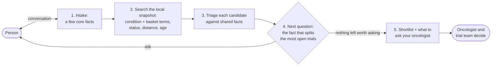

# Finding a trial for a patient: research for a second proof of concept

**Status:** Research. Written before this repository existed. The one decision since: it lives in its own repository, seeded from the prescreening repository (`trial-prescreening-agent`), which "the prescreening repo" means below.
**Date:** 2026-10
**Question:** What would it take to build an agent that helps a person with cancer find clinical trials worth asking their oncologist about, by asking them questions the way the prescreening agent does?

---

## 1. The person this is for

A person has metastatic colorectal cancer. They've had two lines of chemotherapy, and the last scan showed progression. Their oncologist mentioned "a trial might be an option" and nothing more. That night they open ClinicalTrials.gov, type "colorectal cancer", and get about 1,200 recruiting studies worldwide. Each one has a block of eligibility rules several pages long, written for doctors. They don't know their KRAS status. They aren't sure whether their last regimen counts as "second line", and they don't know what "measurable disease per RECIST 1.1" means.

That's the problem in one paragraph. The registry has everything, and almost none of it is usable by the person who needs it most.

**Why so few people end up in a trial.** A pooled analysis of 13 studies covering 8,883 patients (Unger et al., *JNCI* 2019) followed patients through the decision:

| Where patients dropped out | Share |
| --- | --- |
| No trial available for their cancer type and stage at their institution | 55.6% |
| A trial existed, but they were ineligible | 21.5% |
| Eligible, but didn't enroll | 14.8% |
| Enrolled | 8.1% |

The biggest barrier is structural. The trial exists, just not where the patient is being treated, or nobody looked. A trial finder works on that first row. It's also the row a patient can do something about without their doctor taking the first step.

**What patients know about their own cancer.** This matters because the agent asks the patient, not their chart:

- About 30% of patients didn't remember having genomic testing. Among those who did, 44–57% couldn't accurately recall their gene-level results when checked against the record (single-center study, n=85).
- In advanced non-small cell lung cancer (NSCLC), over 40% weren't aware they had received biomarker testing (4R Oncology pre-implementation survey).
- In a global NSCLC survey, 19% of patients fully understood their biomarker results.

So the agent has to work when the patient doesn't know. "I don't know" is the expected answer to the most important questions, not an edge case. The output has to turn those gaps into a short list of things to get from the care team.

**What NCI already tells patients to do.** NCI's guidance is six steps. Gather details on a checklist (type, stage, past treatments, tumor genetic changes, health status), search several sources, review each trial's eligibility, contact the trial team, ask questions, and make an appointment. NCI also runs a free human service: the Cancer Information Service, 1-800-4-CANCER, option 2. Its specialists search for trials with the caller. This PoC would automate steps 1 to 3 and hand off before step 4. The human service is also the honest benchmark for what "good" looks like.

---

## 2. How big the search is, measured

All counts below are live queries against the ClinicalTrials.gov API v2 (API 2.0.5, data timestamp 2026-10-16), run while writing this.

**The funnel:**

| Filter | Studies |
| --- | ---: |
| Everything in the registry | 607,349 |
| Recruiting | 64,802 |
| Recruiting, cancer (`query.cond=cancer`) | 18,814 |
| ...and interventional | 14,360 |
| ...and at least one US location | **5,740** |
| Recruiting, interventional, US, NSCLC | 469 |
| Recruiting NSCLC within 50 miles of Chicago (no other filters) | 115 |
| For comparison: *not yet* recruiting, cancer, interventional, worldwide | 5,099 |

`query.cond=cancer` and `query.cond=neoplasm` return the same 14,360, so the registry already expands synonyms. Filtering on MeSH ancestry (`AREA[ConditionAncestorTerm]Neoplasms`) returns fewer, 11,197, because not every record is MeSH-coded. **Use the registry's own condition search, not the MeSH fields alone.**

The structured filters (condition, status, type, country, distance) take a patient from 600,000 records to somewhere between 50 and 500. That last few hundred is where a model is needed. Everything above it is a database query.

**What's in the 5,740 recruiting US cancer trials.** I downloaded them (32 MB of JSON, six requests) and measured:

- **Eligibility text:** median 2,822 characters per trial, 90th percentile 8,749, 22.6 MB in total. That's about 5.7 million tokens of eligibility prose.
- **Phases:** Phase 2 2,443, Phase 1 2,003, no phase (device, behavioral) 1,371, Phase 3 537. Phase 1/2 studies count in both. Most of what a patient out of standard options will see is early-phase.
- **Sponsors:** 65% academic or other, 29% industry, 4% NIH.
- **Condition vocabulary is chaos:** 6,486 distinct condition strings. 271 distinct strings contain "lung", for example "non-small cell lung cancer", "non small cell lung carcinoma", "carcinoma, non-small-cell lung" and "nsclc (advanced non-small cell lung cancer)".
- **Basket trials hide from a disease search:** about 1 in 7 (834, 14.5%) list only a generic condition such as "advanced solid tumor" or "malignant solid neoplasm" and no specific cancer. Searching "colorectal cancer" finds 1,192 recruiting interventional trials. A further 265 "solid tumor" trials mention colorectal somewhere in their text. These are often exactly the biomarker-driven early-phase trials a patient out of options most needs. **A finder that searches only the patient's cancer type misses them.**
- **Sites:** the median trial has one recruiting US site; the 90th percentile has 16. 69 list none as recruiting. Distance is a real filter, not a nicety.
- **Freshness:** 5,025 of 5,740 (88%) were updated in 2026. 374 haven't been updated in over a year, and 185 still say "recruiting" with a completion date already past. That matches the literature: a 2017 *BMJ Open* sample found 31% of trials had a wrong recruitment status or a status more than a year late. Stale records should be marked, not hidden.

**What the eligibility rules ask about,** as a share of the 5,740 trials (rough keyword counts, good enough to rank priorities):

| Topic | Share of trials | Can the patient answer? |
| --- | ---: | --- |
| Performance status (ECOG / Karnofsky) | 66% | Yes, if asked in plain words ("How much of the day are you up and about?") |
| Pregnancy / contraception | 64% | Yes |
| Washout windows ("within 28 days of...") | 58% | Partly: dates of last treatment |
| Lab values (blood counts, liver, kidney) | 43% | No: needs records, and changes week to week |
| Prior lines / types of therapy | 42% | Mostly, with help ("What did you have, and did it stop working?") |
| HIV / hepatitis | 41% | Yes |
| A named biomarker (EGFR, PD-L1, HER2, ALK, BRAF, KRAS, ...) | 31% | Often not: see section 1 |
| Measurable disease (RECIST) | 33% | No, but "Did your last scan show tumors growing?" gets close |
| Brain / CNS metastases | 25% | Yes, usually |
| Cardiac (QTc, ejection fraction) | 24% | Rarely |

The pattern is useful. **A small set of facts settles most trials:** diagnosis and histology, stage and whether it has spread (and to the brain), treatments received and how each ended, a few biomarkers, how active the person is, age, and location. Labs and cardiac measures almost never knock a trial off a patient's list at the search stage. They decide eligibility at the site.

---

## 3. Where trial data comes from

**ClinicalTrials.gov API v2.** Free, no key, JSON. The prescreening app's `src/trials/registry.ts` already calls it.

- `/studies` with `query.cond`, `query.term`, `query.intr`, `query.locn`, `filter.overallStatus`, `filter.geo=distance(lat,lon,50mi)`, `filter.advanced` (Essie expressions, e.g. `AREA[StudyType]INTERVENTIONAL AND AREA[LocationCountry]"United States"`), `fields=` to trim, `pageSize` up to 1,000, with `nextPageToken` paging and `countTotal=true`.
- Structured fields worth using: conditions and keywords, MeSH-derived condition terms, phases, interventions, minimum and maximum age, sex, healthy volunteers, and each location's status, city and geo-point. Eligibility itself is one free-text block.
- The data refreshes daily. There's no published rate limit; third-party tooling assumes about 50 requests a minute. Downloading all 5,740 US cancer trials took six requests, so a nightly snapshot is cheap.

**NCI Clinical Trials Search (CTS) API v2** (`clinicaltrialsapi.cancer.gov`). It needs a free API key; I confirmed an unauthenticated call returns 401. It's built on NCI's Clinical Trials Reporting Program and adds what ClinicalTrials.gov lacks: disease codes from the NCI Thesaurus, and for some trials, biomarker eligibility abstracted into standard terms. One 2026 analysis found structured biomarker data on 5,044 of 20,894 interventional trials (24%). It covers trials reported to NCI, which is not every industry trial. It's worth a later slice for biomarker matching. ClinicalTrials.gov alone is enough to start, and it keeps one data source.

**Recommendation:** keep a local snapshot of recruiting US cancer trials, fetched by a script and refreshed on demand. Searches then run against the snapshot, so the running app makes no network calls during a search. It's the same pattern the prescreening repo uses for its corpus, and it keeps the existing constraint intact.

---

## 4. What already exists

### Research

| Work | What it does | Key numbers | What to take from it |
| --- | --- | --- | --- |
| **TrialGPT** (NIH/NCBI; Jin et al., *Nature Communications* 2024) | Three stages: retrieval (LLM-generated keywords + hybrid search), criterion-level matching, ranking | Retrieval recalled >90% of relevant trials using <6% of the collection. Criterion accuracy 87.3% vs experts' 88.7–90.0%. Screening time cut 42.6% | The architecture to start from. Code is public (`ncbi-nlp/TrialGPT`) |
| **TrialGPT 2.0** (Fang, Jin et al., arXiv 2609.01202, 2026-09) | Adds a "matching policy" that ranks by clinical value, not just eligibility. BM25 + MedCPT retrieval with reciprocal rank fusion, only for pools over 1,500 trials. Per trial: eligible reasons, missing information, ineligible reasons, fit score 0–100, confidence | About 91% of cases had a clinician-recommended trial in the top 10. Clinician screening time cut 55%. Six months in a live precision-oncology tumor board. ~22 s per recommendation | **83.2% of candidates were "eligible but not recommended."** Eligibility isn't the same as worth pursuing. **Missing information lowers confidence; it never rules a trial out.** The system alone made 8 severe over-recommendations, versus 1 with a clinician reviewing |
| **NIH-TrialBench** (released with TrialGPT 2.0) | 126 synthetic patient vignettes written by 24 NIH investigators across 11 institutes, each built around a target trial, against a 1,373-trial pool | 990 clinician-reviewed pairs, labelled Recommended / Eligible but not recommended / Ineligible | A ready-made, clinician-written, PHI-free test set. Its oncology share and license need checking |
| **TrialMatchAI** (arXiv 2505.08508; *Nature Communications* 2026) | Open, locally deployable: entity normalization, hybrid retrieval, re-ranking, criterion-level chain-of-thought with fine-tuned open models | 92% of oncology patients had a relevant trial in the top 20. >90% criterion-level accuracy by expert review | Evidence that a local, open-model pipeline is viable, which fits the local-first constraint |
| **TREC Clinical Trials track** 2021, 2022, 2023 (NIST) | Shared retrieval task. 2021: 75 synthetic patient notes. 2022: 50. Judged 0 not relevant / 1 excluded / 2 eligible, ~35,000 judgments a year. **2023 replaced notes with a questionnaire a patient or clinician fills in** | Scored by NDCG | Public ground truth for retrieval. The 2023 questionnaire format is the closest public analogue to this product, but its eight disorders don't include cancer |
| **Systematic review** (arXiv 2509.19327) | 31 LLM trial-matching studies, 2020–2025 | 16 used only synthetic data. GPT-4 beat fine-tuned models where compared, at higher cost | Evaluation is inconsistent across the field. A clearly measured PoC is itself a contribution |

### Products and services

- **Massive Bio (SYNERGY-AI app).** Company claims: 200,000+ patients onboarded and 19,000+ oncology trials, with physicians reviewing matches. Patient-facing, and it collects records.
- **LUNGevity Clinical Trial Finder and EmergingMed.** Filter-based search by lung cancer type, stage and location, plus a human navigator service.
- **NCI's Find a Clinical Trial and the Cancer Information Service.** A structured search form on cancer.gov, plus human specialists by phone and chat.
- **Outcomes4Me, CancerBot and others.** Consumer apps with trial matching as a feature.

### Where the gap is

Almost every research system starts from a complete patient description: a clinical note, an EHR extract or a vignette. The products either use filter forms, which a patient can fill in but which miss basket trials and say nothing about eligibility, or they ask for medical records and put a human in the loop.

**Nobody has published a measured answer to this question: starting from a patient who knows only part of their own history, how close can a conversation get to the shortlist a full record would produce, and how many questions does it take?** That's the thesis for this PoC. It's narrow enough to measure, and it extends what the prescreening repo already does (a conversation that abstains when it can't settle something) rather than repeating TrialGPT.

---

## 5. A design

### The shape

### 1. Intake: a fixed core, in plain words

About eight questions, always asked, because they drive the search itself:

| Fact | Plain-language question | If unknown |
| --- | --- | --- |
| Cancer type and subtype | "What kind of cancer is it, and did they say what type of cell, like adenocarcinoma?" | Search the broader type; add subtype to the "ask your doctor" list |
| Stage / spread | "Has it spread beyond where it started? Where to?" | Assume advanced if they're asking about trials after treatment stopped working, and say so |
| Brain involvement | "Has it ever spread to the brain or spine?" | Keep the trial; flag it |
| Treatments so far | "What treatments have you had, roughly in order? For each, did it stop working, or did you stop because of side effects?" | Keep trials open; list it |
| Biomarkers | "Was your tumor tested for genetic changes? Do you remember any names, like EGFR, KRAS or HER2?" | **The most common unknown. Never excludes.** It becomes the top "ask your doctor" item, with the reason |
| Activity level | "Which is closest: working normally / up and about but tired / in bed or a chair half the day or more?" | Ask again in other words; this maps to ECOG |
| Age | "How old are you?" | — |
| Where and how far | "What city or ZIP code? How far could you travel, and how often?" | Default 100 miles, editable |

Plus preferences people do have opinions about. Is a Phase 1 trial acceptable? Would they be willing to stay overnight near the site? Is a trial that might give placebo alongside standard treatment acceptable? These aren't eligibility, but TrialGPT 2.0's finding is that "worth pursuing" depends on them.

### 2. Search

A deterministic query against the local snapshot. It needs no model:

- Condition terms for the type, **plus the basket terms** ("solid tumor", "advanced cancer", "malignant neoplasm") filtered by whether the eligibility text mentions the patient's type or biomarker.
- Status: recruiting or not yet recruiting. Interventional. Age and sex within range. At least one recruiting site within the travel radius.
- Records past their completion date, or not updated in a year, are kept but marked "may not be enrolling."

For a typical patient this yields 50–500 candidates. **Retrieval recall is measurable at this stage with no model at all:** for a vignette with known eligible trials, how many survive the query? That's the first thing to measure. A trial the query drops can never be found later.

### 3. Triage against shared facts: the technical bet

The prescreening repo parses one trial into its own checklist and asks every question on it. That doesn't scale to 300 trials: nobody answers 300 checklists. The new idea is a **shared fact vocabulary**. Each trial's criteria are mapped, at parse time and offline, onto a small set of canonical patient facts, for example `had_pd1_or_pdl1_inhibitor`, `brain_mets_active`, `egfr_status`, `lines_of_systemic_therapy_metastatic`, `ecog`, `measurable_disease`. One answer then updates every trial that depends on that fact.

- Criteria that map to a shared fact are triaged across all candidates at once.
- Criteria that don't map stay with their trial. They're asked only once the trial reaches the shortlist, **by the existing per-trial prescreening agent**. This is the clean reuse point: the old product becomes stage two of the new one.
- Each trial's state for each fact is one of: fits, rules it out, unknown. **Unknown never excludes**, which matches both the prescreening repo's abstention rule and TrialGPT 2.0's design.

The parse can happen offline, since the snapshot is local:

| Scope | Trials | Local model (≈30 s per 1k chars to 2 min per 11k, from the prescreening repo's timings) | Hosted, rough |
| --- | ---: | --- | --- |
| US recruiting NSCLC | 469 | ~7 hours, overnight | well under $5 |
| All US recruiting cancer | 5,740 | ~3–4 days of machine time | roughly $30–60 on Haiku 4.5 (half with batch); under $10 on the cheapest OpenAI model |

These are estimates from the measured token volume (5.7M tokens of eligibility text, plus prompt overhead and output). They'd be checked with a dry run before any spend.

### 4. Choosing the next question

After intake, every candidate has some facts settled and some unknown. The agent picks the unasked fact that **would change the status of the most still-open trials**, weighted toward the trials currently ranked highest. If 40 of 60 open trials hinge on EGFR status, that's the next question. If the patient doesn't know, the agent stops asking about it and moves on.

It stops when no remaining question would move anything in the top of the list, or after a fixed budget of questions. It's a simple information-gain loop that a deterministic test can pin, with no model needed to choose the question. The model's job is to phrase the question, read the answer into a fact, and recognize "I don't know."

### 5. The handoff: a shortlist, never a verdict

For each shortlisted trial:

- what it's testing, in plain language, and its phase, with an honest one-liner on what that phase means;
- **why it may fit**, citing the patient's own words;
- **what's still unknown**, and who could answer it (the patient, the oncologist, the trial team);
- **what might rule it out**;
- the nearest recruiting site and its distance, the contact listed, and when the record was last updated.

Plus one page for the oncologist visit: the details to bring (pathology report, biomarker report, treatment dates) and the specific questions that would settle the most trials.

**No line anywhere says "you are eligible" or "you should join."** This mirrors the prescreening repo's rule that the coordinator decides. Here the oncologist and the trial team decide, and the tool says so.

### Ranking

Ranking needs a stated policy. Order by how many shared facts fit, then fewest unknowns, then distance. Never by "chance of benefit," which nothing here can estimate. Like the prescreening repo's coordinator review, the ranking rule should be pinned by a test so a model can't quietly reorder by outcome.

---

## 6. How to measure it

The prescreening repo's rule carries over: the eval harness is the primary artifact.

**Ground truth, in order of cost:**

1. **Vignettes against the pinned NSCLC snapshot.** Claude-authored synthetic patients, each with trials labelled eligible / excluded / unknown, and each with a **knowledge profile** saying what the simulated patient knows (for example: knows they had chemotherapy, doesn't know EGFR status, thinks they're stage 4). The same approach as the prescreening repo. It needs an independent reader for the labels, as before.
2. **NIH-TrialBench.** 126 clinician-written vignettes with reviewed recommendations, and the closest public match to this task. Check the oncology count, the license, and whether its 1,373-trial pool can be reconstructed.
3. **TREC 2021/2022.** Physician-judged eligible/excluded labels against a 2021 registry snapshot. Use the cancer topics for retrieval recall only, since those trials have long since closed.

**What to compare.** Run the same vignette three ways:

- **Full record → matcher.** The upper bound, as TrialGPT does it.
- **Form only:** the eight intake facts, no follow-up.
- **Conversation:** intake plus adaptive questions, with the simulated patient answering only what its knowledge profile allows.

The gaps between the three are the finding. The question is how much of the full-record result a conversation recovers, and how many questions that takes.

**Metrics:**

| Metric | Why |
| --- | --- |
| Recall of eligible trials in the shortlist (and at the search stage) | **The costly error for this person is a trial they never hear about.** Recall comes first |
| Excluded trials in the top 10 | The other cost: false hope, wasted calls to trial teams |
| Questions asked | Patient burden. Fewer is better at equal recall |
| Unknowns correctly turned into "ask your doctor" items | The behavior that matters when the patient doesn't know |
| Never-excluded-on-unknown | A hard rule, checked deterministically on every run |
| Every reported number records model, quantization, temperature, seed | As in the prescreening repo |

---

## 7. Constraints, risks and ethics

**Carry over unchanged.** No PHI: synthetic patients only. No patient contact: the tool never contacts a trial site; the person does. Local model by default. No cloud deployment. A person decides. Hosted models are opt-in and capped.

**New because this one faces patients:**

- **Regulation.** FDA's revised Clinical Decision Support guidance (2026-01) covers software for clinicians and sets no new policy for patient-facing tools. Law-firm readings say software giving treatment recommendations straight to a layperson almost always counts as a device. Pointing someone to registry entries and questions for their doctor is a different thing from recommending a treatment, and the design should stay clearly on that side: show registry information, explain fit and unknowns, recommend nothing. For a local PoC used with made-up patients this is moot, but the wording of the output should be written as if it weren't. This is a reading of secondary sources, not legal advice.
- **Privacy, if it were ever real.** A direct-to-consumer health app isn't covered by HIPAA. The FTC's Health Breach Notification Rule (amended 2024-04, in force 2024-07) does cover such apps, and state laws such as Washington's My Health My Data Act add consent rules. A person describing their cancer to a hosted model is exactly the data those rules cover. That's one more reason for the local model to be the default.
- **False hope.** The persona's line, "any option, to give you a chance at curing your disease", is the real emotional state, and the tool mustn't exploit it. Most trials such a person will see are Phase 1 or 2. The output should say plainly what a phase means, never rank by imagined benefit, and always route back to the oncologist.
- **Stale listings.** Around 6–7% of the "recruiting" US cancer trials measured above show signs of staleness. Mark them, and don't promise a trial is open.
- **Equity.** The median trial has one US site. Distance and travel are the real filter for most people, so the tool should show them honestly rather than hide far-away trials.

---

## 8. The hard problems, ranked

1. **Mapping criteria to shared facts.** Everything depends on it, and it's where the parser's known weakness bites. The prescreening repo measured that more than half of patient-answerable criteria reached the agent mis-typed as "clinical". Start with a small fixed vocabulary of about 25–40 facts, and measure coverage: what share of criteria map.
2. **Basket and biomarker trials.** High value, invisible to a disease-only search, and they depend on the facts patients know least.
3. **Prior-therapy logic.** "Progressed on a PD-1 inhibitor with no intervening therapy" is the failure TrialGPT 2.0 reported from its live tumor board. Lines of therapy are hard for patients to report and for models to count.
4. **Building ground truth without a clinician.** The prescreening repo's labels were Claude-authored and flagged as needing an independent reader. That gets harder here, because labels now cover hundreds of trials per vignette, not one. NIH-TrialBench may be the way around it.
5. **Ranking without a verdict.** A useful order that never implies "this one is best for you."

---

## 9. A possible path, if it goes ahead

**Decided: a new repository** (2026-10, owner). The user is different (a patient, not a coordinator), the network shape is different (a snapshot of thousands of trials, not one fetched on a click), and the prescreening repository has been closed out. This repository was seeded by copying the parts that carry over: `src/models/` (adapters, budget, catalog), `src/criteria/` (the parser), `src/screening/` (as stage two), `src/plain/`, `src/trials/`, `src/transport/`, the eval pieces their tests need, and the boundary tests. It keeps the same intent → spec → plan → slice process.

Sketch of slices, each measurable on its own:

| Slice | What | Measured by | Model? |
| --- | --- | --- | --- |
| 0001 Snapshot | Fetch and pin recruiting US cancer trials; local search with basket terms, distance, status | **Search-stage recall** on TREC cancer topics and a first set of vignettes | No |
| 0002 Fact vocabulary | 25–40 canonical patient facts; map NSCLC criteria onto them offline | Coverage (share of criteria mapped) and mapping accuracy on hand-labelled trials | Yes, overnight local |
| 0003 Question selection | Deterministic next-question choice; simulated patient with a knowledge profile | Questions to a stable shortlist; recall vs full record | Yes |
| 0004 Shortlist and handoff | The page: conversation, shortlist with reasons and unknowns, oncologist sheet | Browser test; never-a-verdict test | No (fake mode) |
| 0005 Stage two | Hand a shortlisted trial to the existing prescreening agent | End-to-end on vignettes | Yes |
| 0006 Benchmark | NIH-TrialBench and TREC runs; comparison write-up | The three-way comparison in section 6 | Yes |

Slice 0001 needs no model and answers the question everything else depends on: **does a structured search keep the trials that matter?** If it drops a third of eligible trials, no conversation can recover them.

---

## Sources

- ClinicalTrials.gov API v2, live queries 2026-10 (`https://clinicaltrials.gov/api/v2/studies`, `/version`, `/stats/size`)
- Unger JM et al., "Systematic Review and Meta-Analysis of the Magnitude of Structural, Clinical, and Physician and Patient Barriers to Cancer Clinical Trial Participation," *JNCI* 2019. Summary: [Fred Hutch](https://www.fredhutch.org/en/news/center-news/2019/02/patient-barriers-to-cancer-clinical-trials.html)
- Jin Q et al., "Matching patients to clinical trials with large language models," *Nature Communications* 15 (2024), [doi:10.1038/s41467-024-53081-z](https://doi.org/10.1038/s41467-024-53081-z); [TrialGPT at NCBI](https://www.ncbi.nlm.nih.gov/research/trialgpt/)
- Fang Y, Jin Q et al., "Towards AI-Assisted Clinical Trial Matching: Practical Considerations, Multicenter Evaluation, and Real-World Deployment," [arXiv:2609.01202](https://arxiv.org/abs/2609.01202) (TrialGPT 2.0, NIH-TrialBench)
- TrialMatchAI, [arXiv:2505.08508](https://arxiv.org/abs/2505.08508); [*Nature Communications* 2026](https://www.nature.com/articles/s41467-026-70509-w)
- "A systematic review of trial-matching pipelines using large language models," [arXiv:2509.19327](https://arxiv.org/abs/2509.19327)
- TREC Clinical Trials track: [2021](https://trec.nist.gov/data/trials2021.html), [2022](https://trec.nist.gov/data/trials2022.html), [2023](https://trec-cds.org/2023.html)
- NCI, [Steps to find a clinical trial](https://www.cancer.gov/research/participate/clinical-trials-search/steps); NCI Clinical Trials Search API, [clinicaltrialsapi.cancer.gov](https://clinicaltrialsapi.cancer.gov/)
- NCI RFI on patient–trial matching and structured biomarkers, [NOT-CA-18-063](https://grants.nih.gov/grants/guide/notice-files/NOT-CA-18-063.html)
- Recruitment status accuracy: [*BMJ Open* 2017](https://bmjopen.bmj.com/content/7/10/e017719); [PMC4205089](https://www.ncbi.nlm.nih.gov/pmc/articles/PMC4205089/)
- Patient recall of genomic results: [PMC8649013](https://pmc.ncbi.nlm.nih.gov/articles/PMC8649013); [ASCO abstract](https://ace.asco.org/content/428052/abstract/227814); [ESMO 2024 abstract 204P](https://oncologypro.esmo.org/meeting-resources/esmo-congress-2024/assessing-biomarker-testing-awareness-among-patients-and-caregivers-in-nsclc-through-an-interdisciplinary-global-survey?page=3)
- Products: [Massive Bio](https://massivebio.com/); [LUNGevity trial tools](https://alk.lungevity.org/finding-clinical-trials-lung-cancer-tools-and-resources); [CancerBot](https://cancerbot.org/)
- FDA CDS guidance (2026): [FDA](https://www.fda.gov/regulatory-information/search-fda-guidance-documents/clinical-decision-support-software); [Covington summary](https://www.cov.com/en/news-and-insights/insights/2026/01/5-key-takeaways-from-fdas-revised-clinical-decision-support-cds-software-guidance)
- FTC Health Breach Notification Rule: [Jones Day summary](https://www.jonesday.com/fr/insights/2024/07/ftc-issues-final-health-breach-notification-rule)

**Not verified first-hand:** the exact NCI CTS API field names, NIH-TrialBench's license and oncology share, TREC's count of cancer topics, and the full text behind abstract-only figures. Check these before building on them.
